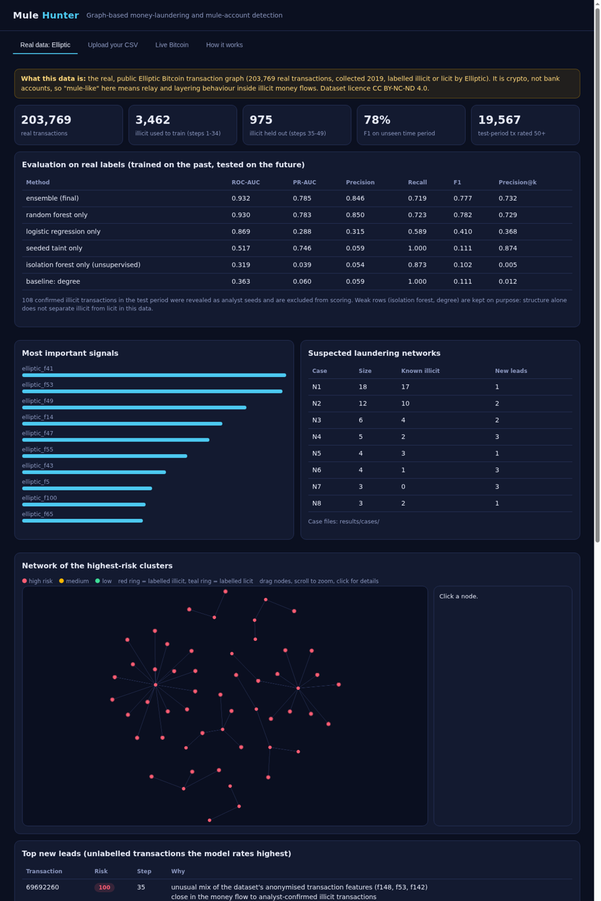
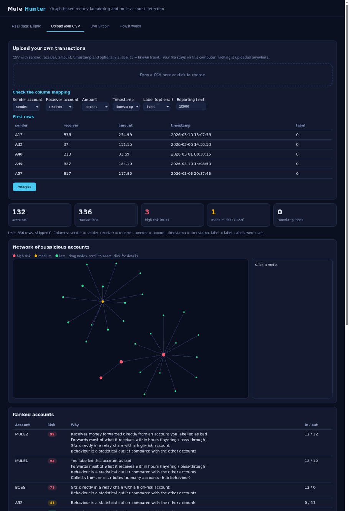
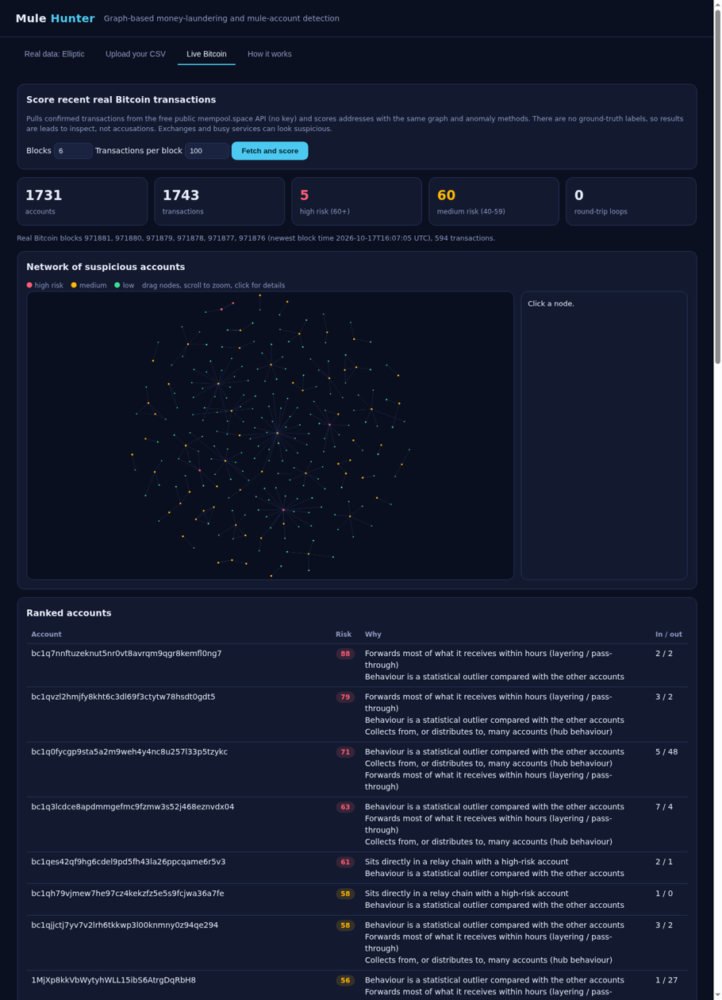

# 1. What this project is

A **money mule** is a person or account used to move money that came from crime. Criminals do not keep stolen money where the victim sent it. They pass it through a chain of accounts, split it, loop it, and finally cash it out through an ATM or a crypto exchange. Each step looks small and ordinary. The pattern only shows up when you look at the whole flow of money.

**Mule Hunter** does that. It reads transactions, builds the money-flow graph, and gives every account or transaction a risk score from 0 to 100 together with plain-language reasons. It has three modes in one local web app:

1. **Real data: Elliptic.** 203,769 real Bitcoin transactions labelled illicit or licit. Used to train and honestly evaluate the models.
2. **Upload your CSV.** Any transaction file with sender, receiver, amount, timestamp and an optional label.
3. **Live Bitcoin.** Recent confirmed transactions from the free public mempool.space API, scored with no keys.

**Honest framing (say this first in a viva):** the built-in data is real labelled *crypto* transactions, not bank accounts. No open dataset of real bank mule accounts exists. The behaviour that makes a mule (relaying money quickly, fan-in, fan-out, layering) appears in crypto laundering in the same way, so the methods transfer.

{width=88%}

# 2. The data

| | Elliptic Data Set |
|---|---|
| What | Bitcoin transaction graph. A node is a transaction, an edge means bitcoin flowed from one transaction into another |
| Size | 203,769 transactions, 234,355 edges, 49 time steps (about two weeks each) |
| Labels | 4,545 illicit, 42,019 licit, 157,205 unknown (about 23% labelled) |
| Features | 166 per transaction: time step, 93 local (inputs, outputs, fees, amounts) and 72 aggregated over neighbours. Anonymised by Elliptic |
| Licence | CC BY-NC-ND 4.0: non-commercial, no derivatives. The repo does **not** contain the data; `--download` fetches it |
| Source | kaggle.com/datasets/ellipticco/elliptic-data-set (downloaded from a public Hugging Face mirror, no login needed) |

Datasets considered and why they were not the main choice: Elliptic++ (real wallet addresses, but on Google Drive only and no stated licence), Elliptic2 (large laundering subgraphs), the RBIH x IIT Delhi mule dataset (real mule labels but 16 GB, hackathon data on an unofficial mirror with no licence), IBM AML (synthetic by design), UCI BitcoinHeist (address features only, no graph), ICIJ FinCEN Files (suspicious-activity records under restrictive terms, no mule labels).

# 3. Architecture

```
 CSV upload  ──┐
 Live Bitcoin ─┼─► accounts.py ──► relay, cycles, hubs, structuring,
 (public API) ─┘                   Isolation Forest, label taint
                                        │  noisy-OR risk + reasons
 Elliptic ───► graph.py + features ─► Random Forest + Logistic
               (chains, PageRank,       + seeded taint ──► risk
                2-hop hubs)                  │
                                             └─► case files, clusters
                         all results ──► web.py (local server) ──► browser UI
```

**Folder map**

| Path | Role |
|---|---|
| `run.py` | Command line: `--download`, `--elliptic`, `--serve`, `--csv`, `--live` |
| `mulehunter/data.py` | Downloads and loads Elliptic; caches the 690 MB feature file as a compact binary |
| `mulehunter/graph.py` | Relay chains, PageRank, 2-hop reach, taint propagation |
| `mulehunter/forest.py` | Random Forest, written from scratch |
| `mulehunter/iforest.py` | Isolation Forest, written from scratch |
| `mulehunter/model.py` | Logistic regression and the metrics (ROC-AUC, PR-AUC, F1) |
| `mulehunter/pipeline.py` | Elliptic pipeline: features, time-split training, scoring, clusters |
| `mulehunter/export.py` | Writes results JSON, `metrics.md` and case files |
| `mulehunter/accounts.py` | Account-level analysis used by upload and live modes |
| `mulehunter/upload.py` | CSV column detection and validation |
| `mulehunter/live.py` | Public blockchain API client |
| `mulehunter/web.py`, `static/index.html` | Local web server and interface |
| `tests/` | 11 unit tests on small hand-made examples |

Everything is Python standard library. The models are written from scratch on purpose, so each one can be explained line by line.

# 4. Setup and running

```bash
git clone https://github.com/hadhiabdulla/mule-hunter.git
cd mule-hunter
python3 run.py --download     # one time, about 700 MB
python3 run.py --elliptic     # about a minute; writes results/
python3 run.py --serve        # open http://127.0.0.1:8000
python3 -m unittest discover tests
```

Needs Python 3.9 or newer. On Windows use `python`. The Upload and Live tabs work without the Elliptic steps.

# 5. Detection methods explained

## 5.1 Relay (pass-through) detection

*Idea.* A mule receives money and sends almost the same amount onward within hours. Ordinary accounts keep money, or spend it in many small, unrelated amounts.

*How.* Every incoming transaction is linked to a later outgoing transaction from the same account when the outgoing one follows within 6 hours and carries between 70% and 102% of the amount. The share of an account's incoming transactions that are relayed becomes its relay signal. Chains of links give a **chain depth**: how many accounts the money passed through.

*On Elliptic* the same idea is a structural feature: runs of transactions with exactly one input and one output are relay chains, and their length is a feature.

## 5.2 FIFO dwell time

*Idea.* How long does money sit in an account? Mules hold it for minutes, not days.

*How.* Money in is queued first-in first-out; each outgoing amount consumes the oldest money and records the wait. The amount-weighted mean wait is the dwell time.

## 5.3 Round-trip cycles

*Idea.* Money that leaves an account and comes back through two or three others within days, in similar amounts, is a common trick to fake activity.

*How.* A depth-limited search follows transfers forward in time (3 or 4 accounts, 72 hours, amounts within 75% to 102%) and records loops.

## 5.4 Hubs: fan-in and fan-out

*Idea.* Collector accounts receive from many senders; distributors pay out to many receivers. Only suspicious together with pass-through, because shops and payroll are also hubs.

*On Elliptic* this is 2-hop fan-in and fan-out reach.

## 5.5 Structuring

*Idea.* Repeated deposits just under a reporting limit (default 10,000, editable) to avoid scrutiny.

## 5.6 Isolation Forest (unsupervised anomaly score)

*Idea.* Anomalies are easier to isolate. Random trees split the data on random features at random values; unusual points end up alone after few splits. The score is based on the average path length (Liu, Ting, Zhou 2008).

*Use.* Needs no labels, so it is the anomaly signal for upload and live data. **Honest result:** on Elliptic it performs worse than random (ROC-AUC 0.32), because illicit transactions there look structurally ordinary. That is why it is not used in the Elliptic ensemble.

## 5.7 Random Forest (supervised)

*Idea.* Many decision trees, each trained on a balanced bootstrap sample using random feature subsets; the forest averages their votes. Splits are chosen from 14 quantile bins using Gini impurity.

*Use.* The main Elliptic model: 40 trees, depth 9, trained on 177 inputs (165 dataset features plus 12 graph features). Gives 0.93 ROC-AUC and 0.78 F1 on the unseen future period.

## 5.8 Logistic regression

A linear baseline trained with stochastic gradient descent and class weighting. Weaker (F1 0.41), kept to show the gain from non-linear models, and blended in with a small weight.

## 5.9 Taint propagation (guilt by flow)

*Idea.* If a transaction is confirmed illicit, money that flows from it, and money that flows into it, is more suspect.

*How.* Starting from known-bad seeds, suspicion spreads along edges for up to 4 hops, shrinking by a decay factor and splitting between outgoing edges. It runs in both directions on Elliptic. In upload mode only money forwarded onward from a labelled bad receiver is tainted, never its victims.

*Why seeded.* Elliptic edges never cross time steps, so taint from the past cannot reach the future. Instead a few confirmed test-period illicit transactions (10%) act like an analyst's first findings, and they are removed from scoring so results are not inflated.

## 5.10 Noisy-OR combination (upload and live)

Each signal gets a strength between 0 and 1 and a weight. Risk = 1 minus the product of (1 minus weight times strength). One strong signal is enough; several raise confidence; no single weak signal can reach a high score. Every score ships with the top reasons.

## 5.11 Clusters and case files

High-risk Elliptic transactions that are connected are grouped into suspected laundering networks. Each gets a markdown case file: size, how many are already known illicit, how many are *new leads*, the time span, the highest-risk transactions with reasons, and recommended analyst steps.

# 6. Using the app

## 6.1 Real data: Elliptic tab

Shows the evaluation table, the strongest signals, the suspected networks, an interactive graph of the top clusters, and the highest-risk unlabelled transactions ("new leads"). The graph: drag nodes, scroll to zoom, click a node for its reasons. A red ring marks transactions labelled illicit, a teal ring labelled licit; colour shows risk.

## 6.2 Upload your CSV

1. Open the **Upload your CSV** tab and drop a file.
2. Check the detected column mapping and the first rows; fix any wrong choice.
3. Optionally change the reporting limit.
4. Press **Analyse**.

Format:

```csv
sender,receiver,amount,timestamp,label
ACC001,ACC114,4900.00,2026-03-02 09:14:00,1
ACC114,ACC207,4650.00,2026-03-02 10:02:00,
```

The file never leaves your computer. Rows with a missing party, sender equal to receiver, non-positive amount or an unreadable date are skipped and listed. Maximum 200,000 rows.

{width=80%}

## 6.3 Live Bitcoin

Choose the number of recent blocks and transactions per block and press **Fetch and score**. The app calls the free mempool.space API (falls back to blockstream.info), turns each transaction into address-to-address edges, and scores addresses. There are no labels, so results are leads only; exchanges and busy services can look suspicious. If the public API is unreachable the app says so and nothing else breaks.

{width=80%}

# 7. Results and evaluation

**Protocol.** Train on time steps 1-34 (3,462 illicit, 29,894 labelled). Test on steps 35-49, which the models never saw (975 illicit of 16,562 labelled, after removing 108 analyst seeds). This is a time split, closer to real use than a random split.

| Method | ROC-AUC | PR-AUC | Precision | Recall | F1 | Precision@k |
|---|---|---|---|---|---|---|
| ensemble (final) | 0.932 | 0.785 | 0.846 | 0.719 | 0.777 | 0.732 |
| random forest only | 0.930 | 0.783 | 0.850 | 0.723 | 0.782 | 0.729 |
| logistic regression only | 0.869 | 0.288 | 0.315 | 0.589 | 0.410 | 0.368 |
| seeded taint only | 0.517 | 0.746 | 0.059 | 1.000 | 0.111 | 0.874 |
| isolation forest only | 0.319 | 0.039 | 0.054 | 0.873 | 0.102 | 0.005 |
| baseline: degree | 0.363 | 0.060 | 0.059 | 1.000 | 0.111 | 0.012 |

**How to read it.**

* Precision: of what we flag, how much is truly illicit. Recall: of all illicit, how much we catch. F1 balances both. Precision@k: precision in the top k ranked, where k is the number of true illicit.
* Illicit is only about 6% of test labels, so accuracy would be meaningless; PR-AUC and F1 are the right measures.
* The Random Forest does the heavy lifting (F1 0.78). This is in line with published Random Forest results on Elliptic.
* Seeded taint has weak overall ROC (most transactions get no taint) but a very precise top: 87% of its top-ranked are truly illicit. It finds illicit transactions next to confirmed ones.
* The unsupervised Isolation Forest and the degree baseline fail on this data. Reporting that is part of honest evaluation.
* Known weakness: a darknet market closed at step 43 and models trained earlier lose accuracy afterwards.

**Limitations to state openly:** Elliptic is 2019, Bitcoin only and only 23% labelled; upload and live heuristics are not validated on labelled bank data; pure Python is slow on very large files; scores are for human review, not proof.

# 8. Viva and demo notes

## 30-second pitch

"Mule accounts hide stolen money by passing it along quickly through chains of accounts. I built a tool that reads transaction graphs and scores each account by the shape of its money flow: relays, hubs, loops, and closeness to known-bad accounts. I trained and tested it on a real labelled Bitcoin dataset, 203,000 transactions, using the past to predict the future, and got 0.93 ROC-AUC and 0.78 F1. It also scores your own CSV files and live Bitcoin."

## Demo script (5 minutes)

1. Open the Elliptic tab. Point out the yellow data note, the evaluation table, and the network of clusters. Click a node and read the reasons.
2. Open the Upload tab, drop `sample_transactions.csv`. Show the column mapping, press Analyse, and show how the chain MULE1, MULE2 and BOSS lights up while victims stay low.
3. Open Live Bitcoin, fetch 6 blocks, show the ranked leads and say they are leads, not accusations.
4. Open `results/cases/case_N1.md` as an investigator's handoff.

## Likely questions and answers

**Why Bitcoin and not bank data?** No open real bank mule dataset exists with a usable licence. The pattern that defines a mule, quick relay through a chain of accounts, is the same in crypto laundering, so the methods carry over. I say clearly that this is crypto.

**Is it real data?** Yes. Elliptic is real Bitcoin transactions labelled by a blockchain analytics company. The sample CSV and unit tests use tiny hand-made examples for format and code checking only.

**Why a time split?** Random splits leak information between neighbouring transactions. Training on the past and testing on the future is how it would be used.

**Why did you write the models from scratch?** To make every step explainable and to keep the project dependency-free. The Random Forest and Isolation Forest follow the published algorithms.

**Why does Isolation Forest fail on Elliptic?** Anomaly detection assumes bad things look different. Elliptic's illicit transactions look structurally normal, so unsupervised scoring ranks them as ordinary. I report it instead of hiding it.

**What is taint propagation?** Suspicion flows along money flow from confirmed illicit transactions, shrinking at each hop. It finds transactions linked to known bad ones.

**What is the noisy-OR?** A way to combine independent signals: the account is clean only if every signal fails. One strong signal can raise the score; weak signals cannot reach high risk alone.

**How do you avoid flagging victims?** Taint only flows forward from a bad receiver. Relay and chain signals look at accounts that forward money, not accounts that send it.

**False positives?** Shops, payroll, exchanges and crowdfunding are hubs. Hub signals count only together with pass-through, and every score shows its reasons so an analyst can dismiss it.

**What would you do next?** Graph neural networks on the Elliptic graph, the larger Elliptic++ wallet-level data, calibrating the upload heuristics on labelled bank data, and an analyst feedback loop.

**Is this legal and ethical?** It is defensive: it detects and explains laundering. It uses public data under its licence (non-commercial research), keeps uploads on the local machine, and states that scores are leads, not proof.

# 9. References

* Weber et al., "Anti-Money Laundering in Bitcoin: Experimenting with Graph Convolutional Networks for Financial Forensics", KDD Workshop 2019 (Elliptic Data Set).
* Liu, Ting, Zhou, "Isolation Forest", ICDM 2008.
* Breiman, "Random Forests", Machine Learning 2001.
* Elmougy and Liu, "Demystifying Fraudulent Transactions and Illicit Nodes in the Bitcoin Network for Financial Forensics", KDD 2023 (Elliptic++).
* mempool.space public REST API, mempool.space/docs/api.
